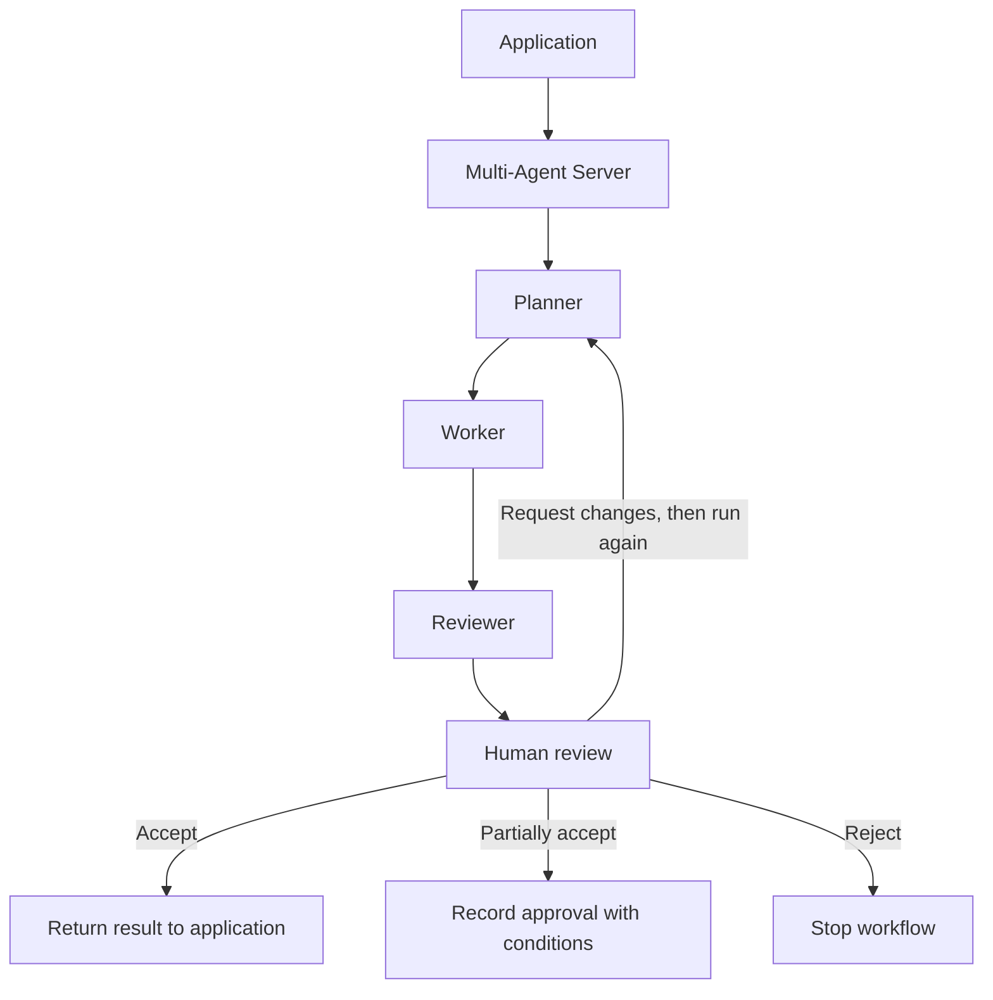

# Multi-Agent Server

- `planner.py` — decides the steps.
- `worker.py` — follows the plan using plant evidence.
- `reviewer.py` — checks the result.
- `human_review.py` — records the user’s decision.
- `application_integration.py` — connects feature backends to this server.



1. `POST /workflow` — save a task.
2. `POST /workflow/run` — send `workflow_id` to run the agents; wait for the response.
3. `GET /workflow/status?id=...` — read the answer, AI review and history.
4. `POST /workflow/review` — send `workflow_id`, `reviewer_id`, `decision` and `feedback`.

Decisions: `accept`, `partially_accept`, `request_changes`, `reject`.
Partial acceptance needs feedback describing what is approved and what remains
unresolved. It closes the review as `partially_accepted`; it does not rerun agents.
Requested changes need feedback;
run again to revise. Accepting despite AI issues also needs a reason.
Human review currently uses these API calls; there is no review screen yet.

Tests (from this folder):

```sh
../../almanac/.venv/bin/python -m unittest discover -s tests -p 'test_workflow.py' -v
```
