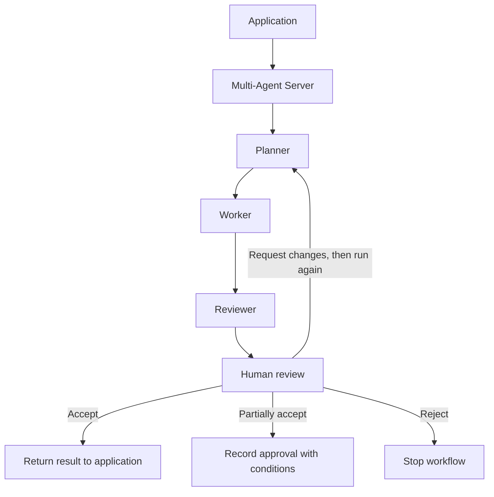

# Multi-Agent Server

- `planner.py` — decides the steps.
- `worker.py` — follows the plan using plant evidence.
- `reviewer.py` — checks the result.
- `human_review.py` — records the user’s decision.
- `application_integration.py` — connects feature backends to this server.



1. `POST /workflow` — save a task. Optional `source` (`almanac` default, `vgarden` or
   `health`) and `evidence` (`{"mode": ..., "passages": [{chunk_id, title, text}, ...]}`, 1–10).
2. `POST /workflow/run` — send `workflow_id` to run the agents; wait for the response.
3. `GET /workflow/status?id=...` — read the answer, AI review and history.
4. `POST /workflow/review` — send `workflow_id`, `reviewer_id`, `decision` and `feedback`.

Decisions: `accept`, `partially_accept`, `request_changes`, `reject`.

### Feature sources

- **`almanac`** — public plant references. The Worker retrieves evidence itself through
  the MCP `retrieve_context` tool.
- **`vgarden`** — private, per-owner garden data. This server never reads it: the Virtual
  Garden backend sends the one garden's records it has already authorised as `evidence`
  (read through MCP `get_garden_snapshot` when MCP is on). A `vgarden` task without
  evidence is rejected. The Planner and Worker get a garden-specific framing; the shared
  grounding rules and the Reviewer are unchanged.
- **`health`** — Plant Health assessments, each the advisory output of a past local model
  run. The health backend sends one plant's stored assessments (read through MCP
  `list_health_assessments` + `get_health_assessment` when MCP is on) as `evidence`, with
  a history summary passage first; a `health` task without evidence is rejected. The
  Planner and Worker are told to report what the records say and never to diagnose.

### Calling the server from a feature backend or the terminal

`application_integration.py` wraps the four calls above in `submit_task(feature, task,
evidence)` (create, then run) and `review_task(workflow_id, decision, feedback)`, using
only the standard library, and doubles as a terminal client:

```sh
python application_integration.py health "Summarise this plant's assessments" evidence.json
python application_integration.py almanac "Tomato sun needs"       # the Worker retrieves via MCP
python application_integration.py --review <workflow_id> accept "Checked" --reviewer guhan-terminal
```

Plant Health flow: records page (HTMX) → `health/workflows.py` → `POST /workflow`
(`source="health"` + this plant's assessments) → `POST /workflow/run` (background thread;
the page polls `GET /workflow/status`) → Planner → Worker → Reviewer → the gardener's
Accept / Partially accept / Request changes / Reject → `POST /workflow/review`. Reviewer id
is the name typed on the review form, else `health-ui`. Terminal run through the health
backend: `bash scripts/test/multi-agent-health.sh "<plant name>"`. Disable with
`MULTI_AGENT_ENABLED=false` (CI and cloud baseline).

Virtual Garden flow: garden page (HTMX) → `vgarden/garden_workflows.py` → `POST /workflow`
→ `POST /workflow/run` (background thread; the page polls `GET /workflow/status`) →
Planner → Worker → Reviewer → owner's Accept / Partially accept / Request changes / Reject
→ `POST /workflow/review` (requested changes start a revised run). Reviewer id is
`vgarden-user-<id>`. Disable with `MULTI_AGENT_ENABLED=false` (CI and cloud baseline).
Partial acceptance needs feedback describing what is approved and what remains
unresolved. It closes the review as `partially_accepted`; it does not rerun agents.
Requested changes need feedback;
run again to revise. Accepting despite AI issues also needs a reason.
Human review uses these API calls. Virtual Garden has a review screen on each garden
page (see below); other features call the API directly.

Tests (from this folder):

```sh
../../almanac/.venv/bin/python -m unittest discover -s tests -v   # workflow, sources, integration, audit
```

Models: Planner and Worker use `qwen3:4b-instruct`; Reviewer uses `qwen3:4b-instruct`.

The Worker receives the original task and prioritises an explicitly named variety.
The Reviewer combines source-field checks with AI review and validates issue quotes.
Live regression check: `../../almanac/.venv/bin/python tests/check_reviewer.py`.

Audit and metrics:

- `GET /workflow/metrics` — rates, counts and stage timings from saved events.
- `GET /workflow/audit/workflow_history.jsonl` — full execution evidence.
- `GET /workflow/audit/coordination_audit.jsonl` — handoffs, models and decisions.
- `../../almanac/.venv/bin/python audit.py` — write both files under `instance/`.

Each new run records its model roles and run ID. Older model names remain unknown.
Exports are snapshots; run the command again to refresh saved files. Startup marks
abandoned runs failed so they can be retried, while preserving live local owners
and workflows waiting for human review. Recovery assumes processes on one host.

Open `/dashboard` for the read-only metrics, timings, workflow states and audit downloads.
