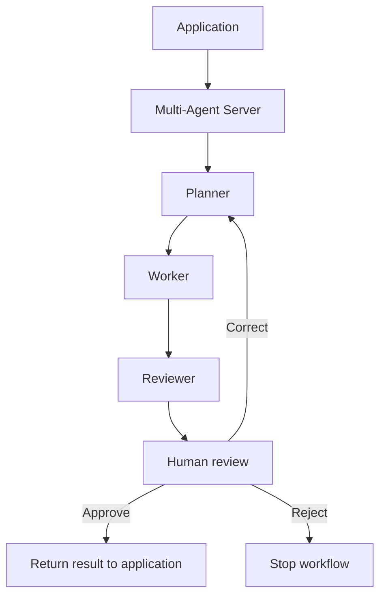

# Multi-Agent Server

- `planner.py` — decides the steps.
- `worker.py` — follows the plan using plant evidence.
- `reviewer.py` — checks the result.
- `human_review.py` — records the user’s decision.
- `application_integration.py` — connects feature backends to this server.

