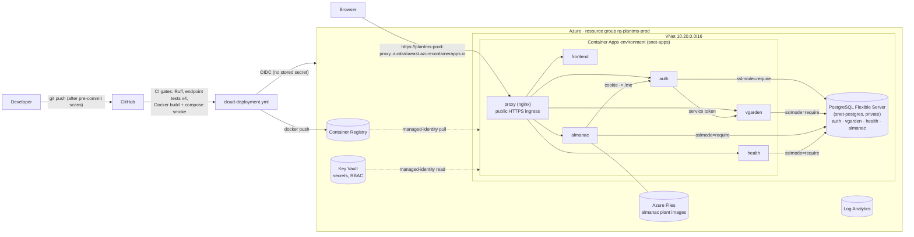

# Cloud deployment on Microsoft Azure

Release 2 deploys the integrated application to Azure from GitHub Actions on every
push to `main`, after the CI gates pass. This page is the walkthrough: what runs in
the cloud, the one-time setup, how a deployment happens, how to verify it, and what
to put in the technical report.

Related files:

| What | Where |
|---|---|
| Workflow (criterion 6) | [`.github/workflows/cloud-deployment.yml`](../../.github/workflows/cloud-deployment.yml) |
| Infrastructure as Code (criterion 5) | [`infra/main.bicep`](../../infra/main.bicep) (platform), [`infra/apps.bicep`](../../infra/apps.bicep) (the six container apps), [`infra/modules/container-app.bicep`](../../infra/modules/container-app.bicep) |
| Reusable deployment scripts (criterion 5) | [`scripts/deploy/`](../../scripts/deploy/) — `azure-bootstrap.sh` (once), `azure-deploy.sh` (everything), and the steps it calls |
| Proxy image (shared with docker compose) | [`shared/proxy/`](../../shared/proxy/) |
| Deployment reports (evidence) | [`docs/evidence/release2/cloud-deployment/`](../evidence/release2/cloud-deployment/) |

## 1. What is deployed

The cloud layout mirrors `docker-compose.yml` one-to-one: the same six images,
the same path routing through one nginx proxy, one database per service. The only
differences are the database engine (PostgreSQL instead of SQLite files), the
process model (gunicorn instead of Flask's debug server) and that nothing is
mounted at run time, so the images carry the shared templates and `ai_loop.py`.



| Local (`docker compose`) | Azure |
|---|---|
| `proxy` on `localhost:3000` | Container app `plantms-prod-proxy`, the only public endpoint, HTTPS only |
| `frontend`, `auth`, `vgarden`, `almanac`, `health` on the compose network | Container apps with **internal** ingress (`*.internal.<env domain>`), unreachable from the internet |
| SQLite file per service | Azure Database for PostgreSQL Flexible Server, one database per service, private VNet access only. `DATABASE_URL` is `postgresql+psycopg2://...?sslmode=require` (the driver is named explicitly: newer SQLAlchemy maps a bare `postgresql://` to psycopg v3, which the images do not ship) |
| `SECRET_KEY=dev-...` in compose | Key Vault secrets read through a user-assigned managed identity |
| `./shared/templates` and `./shared/ai_loop.py` mounted | Baked into each image by `azure-build-push.sh` |
| `almanac_data` volume | Azure Files share mounted at `/app/instance` |
| `ollama` container + host MCP/RAG/Multi-Agent servers | **Not deployed** (cloud baseline, next section) |

### Cloud baseline: AI services disabled by default

The assessment requires AI-Mode, MCP, RAG and the Multi-Agent Server to be off in
the cloud. `infra/apps.bicep` has one parameter per service, all `false` by default,
and `scripts/deploy/azure-config.sh` passes the same `MCP_ENABLED=false`,
`RAG_ENABLED=false`, `MULTI_AGENT_ENABLED=false` that the feature workflows use in CI:

| Service | How it is disabled |
|---|---|
| AI-Mode (Ollama) | `OLLAMA_URL` points at an unreachable local address, `OLLAMA_AUTO_PULL=false`, `OLLAMA_PRELOAD=false`; the model-backed endpoints answer with their "unavailable" responses, `/health/healthz` reports `degraded`, CRUD is unaffected |
| MCP Server | `MCP_ENABLED=false` → tool runs answer 503 "disabled" without contacting a server |
| RAG Server | `RAG_ENABLED=false` → questions answer 503 "disabled" |
| Multi-Agent Server | `MULTI_AGENT_ENABLED=false` → the workflow button is off, `/vgarden/integrations` reports it |

The deployment report records the four values; `azure-smoke.sh` asserts that the
`/integrations` endpoints report exactly this state.

### Bonus profile (B1–B4): the AI services in the cloud

Opt-in only; pushes to `main` always deploy the baseline above. Run the workflow by
hand with **profile = bonus** (or `DEPLOY_PROFILE=bonus` for the scripts):

```bash
gh workflow run cloud-deployment.yml -f profile=bonus            # AI apps scale to zero
gh workflow run cloud-deployment.yml -f profile=bonus -f ai_min_replicas=1 -f service_min_replicas=1   # demo: all warm
gh workflow run cloud-deployment.yml                             # back to the baseline (AI apps unused, scaled to zero)
```

The four switches become `true` and four more **internal-only** container apps join
the environment (`infra/apps.bicep`, `aiServicesDeployed=true`):

| App | Image | Size | Notes |
|---|---|---|---|
| `plantms-prod-ollama` (AI-Mode) | `ollama/ollama:0.40.7`, imported into the registry | 4 vCPU / 8 GiB | CPU inference; `qwen3:4b-instruct` (text) and `qwen2.5vl:3b` (vision) pulled once onto the `ollama-models` Azure Files share; one model in memory at a time |
| `plantms-prod-mcp` | `ai-services/mcp-server/Dockerfile` | 0.5 vCPU / 1 GiB | tools over the features' internal APIs; DNS-rebinding protection allows only its own internal name |
| `plantms-prod-rag` | `ai-services/rag-server/Dockerfile` | 0.5 vCPU / 1 GiB | `cloud_start.py`: gunicorn, index rebuilt from the features at start and every 10 min |
| `plantms-prod-agents` | `ai-services/multi-agent-server/Dockerfile` | 0.5 vCPU / 1 GiB | Planner → Worker → Reviewer; human review stays in each feature's UI |

Every feature reaches them only through its own backend, exactly as locally
(browser → proxy → feature backend → AI app). Model calls stay under the ingress's
240 s request limit (`OLLAMA_TIMEOUT=230`); Plant Health streams its assessment, and
the Multi-Agent runs are polled. The deploy job then runs
`scripts/deploy/azure-ai-e2e.py` (an AI-Mode assessment and chat answer, an MCP tool
run, a grounded RAG answer with citations, a full Planner → Worker → Reviewer → human
review workflow) and keeps its output in `docs/evidence/release2/cloud-bonus/`.
The Dockerfiles are for the cloud only: locally the AI services stay host processes.

## 2. One-time setup

### Prerequisites

- An Azure subscription where you are **Owner**. The team uses an **education
  (Azure for Students) subscription**, which is signed in with the student account,
  not a work account; see the note below. It costs about US$35–40 a month of the
  credit, see §6.
- [Azure CLI](https://learn.microsoft.com/cli/azure/install-azure-cli) 2.60+,
  signed in: `az login`. Bicep is installed on demand.
- Docker (to run the scripts from a laptop; GitHub Actions has it already).
- `gh` CLI signed in as a repository **admin**, or someone who can add repository
  secrets by hand.
- A bash shell: Git Bash or WSL on Windows, Terminal on macOS/Linux.

### Using an education (Azure for Students) subscription

- **Sign in with the student account, in its own tenant.** A machine that is also
  signed in to a work tenant will default to the wrong subscription. Sign in
  explicitly and check before running anything:

  ```bash
  az login --use-device-code --tenant <student tenant id or domain>
  ```

  ```bash
  az account show --query "{name:name, id:id, user:user.name}" -o table
  ```

  Pass that subscription id to the bootstrap as `AZURE_SUBSCRIPTION_ID`; the script
  calls `az account set` with it, so it never deploys to whatever happens to be the
  default. Never use a corporate or Visual Studio subscription for this project.
- **No Entra app registration is needed.** GitHub authenticates through a
  user-assigned managed identity with a federated credential, which only needs
  Owner on the subscription. University tenants often block creating app
  registrations; this design avoids that.
- **Offer and quota limits.** The student offer has a spending limit (resources
  pause when the credit is gone; no card is charged), small vCPU quotas, and some
  SKUs or regions are not available to it. If `azure-platform.sh` fails with
  `SkuNotAvailable`, `OfferNotAvailable` or a quota error, change the region
  (`AZURE_LOCATION=australiasoutheast` or `southeastasia`) or the database SKU
  (`Standard_B1ms` is the cheapest; the parameter is `postgresSkuName` in
  `infra/main.bicep`), and set the matching repository variable. Everything else in
  the templates is the consumption / basic tier.
- **The deploy identity is the only thing GitHub sees.** The three "secrets" are an
  identity's client id, the tenant id and the subscription id; none of them is a
  credential, and nothing in GitHub can reach any other subscription.

### Step 1 — bootstrap Azure and GitHub (once per subscription)

```bash
az account list -o table                       # pick the subscription id
AZURE_SUBSCRIPTION_ID=<id> bash scripts/deploy/azure-bootstrap.sh
```

The script is idempotent. It registers the resource providers, creates the
resource group `rg-plantms-prod` in `australiaeast`, creates two managed identities
and grants them the minimum roles **on the resource group only**:

| Identity | Used by | Roles |
|---|---|---|
| `id-plantms-apps` | the container apps | `AcrPull`, `Key Vault Secrets User` |
| `id-plantms-github` | GitHub Actions (OIDC) | `Contributor`, `Key Vault Secrets Officer` |

It then federates `id-plantms-github` with this repository (`main` branch and the
`azure-production` environment) and writes three GitHub secrets
(`AZURE_CLIENT_ID`, `AZURE_TENANT_ID`, `AZURE_SUBSCRIPTION_ID`) and four variables
(`AZURE_RESOURCE_GROUP`, `AZURE_LOCATION`, `AZURE_BASE_NAME`, `AZURE_STAGE`). If
`gh` cannot write them (needs admin), it prints the values to add under
*Settings → Secrets and variables → Actions*. None of the three "secrets" is a
credential: OIDC means GitHub proves its identity to Entra ID per run, and nothing
stored in GitHub can be used from anywhere else.

Different name, region or stage: export `AZURE_BASE_NAME`, `AZURE_LOCATION`,
`AZURE_STAGE` before running (see `azure-config.sh`), and set the matching
repository variables.

### Step 2 — the human release gate

In GitHub: *Settings → Environments → `azure-production`* (it appears after the
first workflow run, or create it) → **Required reviewers** → add the team. From
then on every deployment pauses at the deploy job until someone approves it. That
approval, together with the deployment report, is the "final human release
decision" the assessment asks for.

### Step 3 — first deployment

Either push to `main`, or *Actions → Cloud deployment (Azure) → Run workflow*.
The first run takes 15–20 minutes (PostgreSQL and the Container Apps environment
are slow to create); later runs take 6–10. If the first run fails with an
authorization error right after bootstrap, wait a few minutes and re-run: role
assignments take time to propagate.

## 3. How a deployment runs

`cloud-deployment.yml` has four jobs. The deploy job needs all three gates:

| Job | What it proves | Mirrors |
|---|---|---|
| `lint` | Ruff + compile check over the whole repository | `ruff.yml` |
| `endpoint-tests` (×4) | each service's test suite, which contains the two assigned endpoint tests per student; JUnit XML kept as an artifact | `auth.yml`, `vgarden.yml`, `plant_almanac.yml`, `health.yml` |
| `build-validate` | every image builds, the compose stack starts and the two feature smoke scripts pass through the proxy (MCP/RAG/Multi-Agent off) | `integration-ci.yml` |
| `deploy` | the steps below, under the `azure-production` environment | — |

The deploy job calls the same scripts a developer would, in this order:

```text
azure-platform.sh     infra/main.bicep  — network, PostgreSQL, Key Vault (+ secrets), ACR, storage, environment
azure-build-push.sh   docker build x6 (context = service dir + shared/templates + shared/ai_loop.py), push :<sha> and :latest
azure-apps.sh         infra/apps.bicep  — six container apps, image tag = short commit SHA
azure-smoke.sh        HTTPS end-to-end checks + the feature smoke scripts + endpoint-security checks
azure-report.sh       docs/evidence/release2/cloud-deployment/cloud-deployment-<timestamp>.{md,json}
```

`azure-deploy.sh` runs all five. Secrets are generated on the first platform run
and stored in Key Vault; later runs read them back, so redeploying never rotates a
password or logs users out. Every run is idempotent (ARM incremental deployments).

Manual deployment from a laptop (same scripts, same result):

```bash
az login
bash scripts/deploy/azure-deploy.sh
```

Useful knobs (environment variables, or repository variables / workflow inputs):

| Variable | Default | Meaning |
|---|---|---|
| `SERVICE_MIN_REPLICAS` | `0` | Services scale to zero when idle (cheapest). Set `1` before a demo so the first click is instant. |
| `PROXY_MIN_REPLICAS` | `1` | Keep the public endpoint warm. |
| `IMAGE_TAG` | short commit SHA | Redeploy an older tag: `IMAGE_TAG=abc1234 bash scripts/deploy/azure-apps.sh` |
| `STORAGE_RESTRICT_TO_VNET` | `true` | Lock the plant-image storage account to the apps subnet. |

## 4. Verifying a deployment

- The deploy job's environment link and the job summary show the public URL
  (`https://plantms-prod-proxy.<env>.australiaeast.azurecontainerapps.io`). The
  same paths as locally: `/`, `/auth/login`, `/vgarden/`, `/almanac/`,
  `/health/plant-health-records/`.
- `bash scripts/deploy/azure-smoke.sh` repeats the checks from any machine that is
  signed in to Azure (or `azure-smoke.sh <url>` without Azure access, which skips
  the internal-address check).
- Logs:

  ```bash
  az containerapp logs show -g rg-plantms-prod -n plantms-prod-auth --follow
  az containerapp revision list -g rg-plantms-prod -n plantms-prod-almanac -o table
  ```

- Portal: resource group `rg-plantms-prod` → the container apps (revisions,
  console, metrics), the PostgreSQL server (networking: public access *Disabled*),
  Key Vault (secrets, access via RBAC), Log Analytics (query `ContainerAppConsoleLogs_CL`).

Cold start: with `SERVICE_MIN_REPLICAS=0` the first request to an idle service
takes 20–40 seconds (image pull from cache, gunicorn start, migration check). The
smoke script retries for that reason. **auth and vgarden are always kept warm**
(`dependencyMinReplicas=1` in `infra/apps.bicep`): other services call them
server-to-server, and a cold start there showed up as "Couldn't reach the garden
service".

`python3 scripts/deploy/azure-e2e.py <public URL>` goes beyond the smoke test and
uses the site like a person, timing each step: register, add a garden, open it
(SSO), add an area and a planting; the almanac catalogue and logged-in state;
health plant titles and a record saved "not assessed" with AI-Mode off; the AI
baseline.

### Before a demo or marking: keep everything warm

```bash
gh workflow run cloud-deployment.yml -f service_min_replicas=1   # then approve the run
```

Every page is then instant. Afterwards, run it again with `service_min_replicas=0`
(or without `-f`) to go back to scale-to-zero, which costs less.

### Rehearsing the cloud configuration locally

Before the first real deployment the cloud process model was validated on a laptop
with the same staged images, `gunicorn` command, baseline env and a PostgreSQL 16
container: all routes answered through the proxy image, the Alembic migrations of
all four services applied on PostgreSQL, and both feature smoke scripts passed. The
recipe is the `x-gunicorn` / `x-baseline` blocks in `infra/apps.bicep` translated to
a compose file; repeat it after changing a Dockerfile, a migration or the proxy.

## 5. Evidence for the technical report

| Report section | Take it from |
|---|---|
| Cloud reference architecture + DevOps flow | the diagram and tables in §1 and §3 |
| Deployment scripts (criterion 5) | `infra/*.bicep`, `scripts/deploy/*.sh`; execution evidence = the deploy job log and `docs/evidence/release2/cloud-deployment/latest.md` |
| Cloud deployment workflow logs (criterion 6) | the successful *Cloud deployment (Azure)* run: URL, the four gate jobs green, the approval on `azure-production`, the deploy steps |
| Deployed frontend and CRUD (criterion 7) | the public URL in the browser (register, create a garden, add a plant-health record, browse the almanac) and `azure-smoke.sh` output; the report's *Cloud baseline* table shows the four AI services disabled |
| Cloud Deployment Review (criterion 8) | feed `latest.json` / `latest.md` to the shared agentic loop's Cloud Deployment Review mode; keep its review/validation log next to the report |
| Final human release decision | the checklist at the end of the report, plus the environment approval |
| Bonus B1–B4 cloud AI | `docs/evidence/release2/cloud-bonus/` — the bonus deployment report and `ai-e2e.txt` |
| Bonus endpoint security | single public entry point (proxy), HTTPS only with TLS ≤ 1.1 refused, internal-only services and AI apps, security headers (HSTS, CSP, `X-Frame-Options`, `nosniff`, `Referrer-Policy`), per-client rate limits (sign-in 10/min), no server version, dotfiles refused, CSRF on every form, Secure/HttpOnly/SameSite cookies, gunicorn instead of the debug server |
| Bonus data security | PostgreSQL private to the VNet, TLS required (`require_secure_transport`, TLS 1.2+, `sslmode=require`), encrypted at rest with 7-day backups; every secret in Key Vault (RBAC, soft delete) read through a managed identity as Key Vault references; registry without admin user; storage HTTPS/TLS 1.2 only, no public blobs, subnet-restricted, encrypted; OIDC instead of stored cloud credentials; salted password hashes; detect-secrets on every commit |
| Bonus security validation | `scripts/deploy/azure_security_check.py` (read-only; run by the deploy job after the smoke test) → `docs/evidence/release2/cloud-security/latest.md` |

Commit the generated `cloud-deployment-*.md/json` files from the run you cite (the
workflow also uploads them as a 90-day artifact).

## 6. Cost, operations, teardown

Approximate monthly cost in `australiaeast` with the defaults (services scale to
zero, proxy always on): PostgreSQL B1ms + 32 GB ≈ US$17, Container Apps ≈ US$10,
Container Registry Basic ≈ US$5, storage and logs ≈ US$2. Keeping all five services
warm (`SERVICE_MIN_REPLICAS=1`) adds roughly US$9 per service per month; auth and
vgarden are always warm (about US$18 of that). The bonus profile adds the
Ollama app at 4 vCPU / 8 GiB, about US$0.45 for every hour it runs (it scales to zero
after a few idle minutes unless `ai_min_replicas=1`), plus a few cents a month for the
model share; keeping it warm all month would be about US$320, so warm it only for a
demo and redeploy the baseline afterwards. A credit-
based subscription (Visual Studio, Azure for Students) has a spending limit: when
the credit is gone the resources pause instead of charging a card.

Rotate a secret: `AUTH_SECRET_KEY=$(openssl rand -hex 32) bash scripts/deploy/azure-platform.sh` <!-- pragma: allowlist secret -->
then `bash scripts/deploy/azure-apps.sh` (apps read Key Vault at revision start).

Redeploy without rebuilding: `IMAGE_TAG=<existing tag> bash scripts/deploy/azure-apps.sh`.

Delete everything (stops billing):

```bash
bash scripts/deploy/azure-teardown.sh
```

## 7. Troubleshooting

| Symptom | Cause / fix |
|---|---|
| Sign-in fails with `AADSTS700213` (no matching federated identity) | the repository sends GitHub's immutable OIDC subject `repo:owner@id/repo@id:...`; re-run `azure-bootstrap.sh`, which registers both forms |
| A later step fails with `AADSTS700024` (assertion expired) | the OIDC token lasts 5 minutes; the workflow signs in again before each long step |
| Every page answers `426 Upgrade Required` | the proxy must speak HTTP/1.1 to the internal apps (`proxy_http_version 1.1` in `shared/proxy/default.conf.template`) |
| The Platform step stays Running for an hour (`DeploymentActive` on the next run) | the PostgreSQL server is created once and referenced afterwards (`deployPostgres`); cancel a stuck deployment with `az deployment group cancel -g rg-plantms-prod -n plantms-platform` |
| DB apps crash-loop: `password authentication failed for user "plantadmin"` | Key Vault and the server disagree on the password. Set one clean value on both (`az postgres flexible-server update --admin-password`, `az keyvault secret set ... postgres-admin-password`), then rerun the platform and apps steps |
| `SSL error: decryption failed or bad record mac` | gunicorn `--preload` workers shared the start-up DB connection; each app now disposes its engine at the end of `create_app` |
| Health says the model is not available | expected in the cloud baseline (AI-Mode off): new records are saved "not assessed" |
| `az` targets the wrong tenant or subscription | `az login --use-device-code --tenant <student tenant>` then `az account show`; the scripts honour `AZURE_SUBSCRIPTION_ID` for the bootstrap and the signed-in context afterwards |
| `SkuNotAvailable` / `OfferNotAvailable` / quota exceeded on the student offer | try another region (`AZURE_LOCATION`) or a different `postgresSkuName`; the resource group can be deleted and re-created in the new region with `azure-teardown.sh` + `azure-bootstrap.sh` |
| `AuthorizationFailed` in the first deploy after bootstrap | role assignments still propagating; re-run after a few minutes |
| `azure-platform.sh`: `Forbidden` reading a Key Vault secret locally | you need `Key Vault Secrets Officer` on the resource group (bootstrap grants it when it can resolve your user) |
| Almanac revision fails to start, volume mount error | storage network rules; redeploy once with `STORAGE_RESTRICT_TO_VNET=false` and report it |
| `host not found in upstream` in the proxy log | the proxy started before the environment's internal DNS answered; Container Apps restarts it, no action |
| A service answers 503 right after a deploy | cold start or the start-up migration; the smoke script retries for two minutes |
| `/health/healthz` returns 503 `degraded` | expected in the baseline: the model is disabled; CRUD endpoints are unaffected |
| Almanac log: `Could not load My Garden starter data: ... null value in column "summary"` | pre-existing, engine-independent: 3 of the 46 public catalogue records have no summary and the column is NOT NULL, so the import rolls back and the Almanac starts with its 8 built-in plants (CRUD still works). Fix belongs in `almanac/public_seed.py` |
| GitHub: *"No subscriptions found"* in `azure/login` | the federated credential subject does not match; it must be `repo:<owner>/<repo>:ref:refs/heads/main` or `repo:<owner>/<repo>:environment:azure-production` (re-run bootstrap after a repository rename or fork) |
