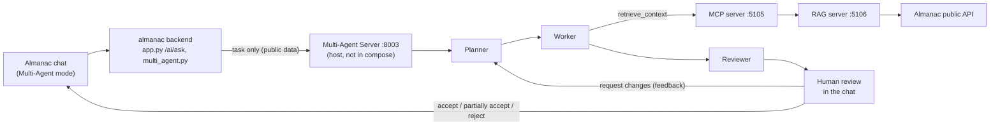

# Multi-Agent workflow evidence: Plant Almanac

Release 2 criteria 1–2 for the Plant Almanac feature: the shared, non-containerised
Multi-Agent Server runs Planner → Worker → Reviewer → Human Review on a question about
the Almanac's plant records, through both the **frontend UI** (the Almanac chat's
*Multi-Agent* mode) and the **terminal**, with workflow history and coordination/audit
evidence.

Recorded 22 Oct 2026 (Australia/Sydney) on an 8 GB M1, with `qwen3:4b-instruct` for all
three agent roles. Almanac ran directly (`flask run --port 5061`, seeded catalogue);
the Multi-Agent Server ran on `:8003`, the shared MCP server on `:5105` and the RAG
server on `:5106`, all on the host (none of them is a compose service).

## Flow



| Step | Where |
| --- | --- |
| Chat mode, review form, readable concerns and saved source facts | `almanac/templates/_almanac_chat.html`, `_ai_history.html`, `_multi_agent_result.html` |
| Routes: ask (`mode=multi_agent`), status, run again, review | `almanac/app.py` (`/ai/ask`, `/ai/multi-agent/<message_id>`) |
| HTTP client and the readable review view | `almanac/multi_agent.py` |
| Worker retrieval for `source="almanac"` (MCP `retrieve_context`) | `ai-services/multi-agent-server/worker.py` |
| Off switch (CI, cloud baseline) | `MULTI_AGENT_ENABLED` defaults to `false` (`almanac/app.py`); `infra/apps.bicep` sets it off in the cloud |

Almanac data is public reference data, so unlike Virtual Garden and Plant Health the
backend sends only the task; the Worker retrieves the Almanac passages itself through
the shared MCP server, and cites them by `chunk_id`. A workflow can only be read or
reviewed from the chat message that started it, by the signed-in owner of that chat
(404 otherwise).

## Terminal runs

From `bash scripts/test/multi-agent-almanac.sh` (reviewer `yunus-terminal`). Both go
`received → planning → working → reviewing → awaiting_human_review →
changes_requested → planning → working → reviewing → awaiting_human_review → <decision>`.

| File | Task | What happened |
| --- | --- | --- |
| [`terminal-run-companions.txt`](terminal-run-companions.txt) | "Tomato companion plants" | Workflow `f0a706d0`. The Almanac has no companion-planting field, so the Worker **refused rather than guessed** ("not recorded in the evidence"); after the requested change it again said what the record does not state. Reviewer `accept` both times → **accepted**. |
| [`terminal-run-planting-months.txt`](terminal-run-planting-months.txt) | "Tomato planting months" | Workflow `8a8bae49`. Correct months from the Tomato record; the requested change (scientific name and family) was added in the revised run, but the Reviewer said `revise`, so the script's cautious default **partially accepted**. |

## UI run (real HTTP, the requests the chat page sends)

[`ui-http-run.txt`](ui-http-run.txt): sign in through auth → `GET` the Almanac page
(Multi-Agent mode offered) → `POST /ai/ask mode=multi_agent` (27 s, Planner → Worker →
Reviewer) → **Request changes** "Also give the scientific name and family of Tomato." →
**Run again** (25 s) → **Partially accept** (the Reviewer said `revise`). Workflow
`120184b5`, decision recorded as the signed-in user `user:2`.

## Audit and review

- [`workflow_history.jsonl`](workflow_history.jsonl) and
  [`coordination_audit.jsonl`](coordination_audit.jsonl): the server's `audit.py`
  records for the three almanac workflows (33 events each);
  [`multi-agent-metrics.json`](multi-agent-metrics.json) is `audit.metrics` for the same
  three workflows (6 runs, every run planned, worked and reviewed).
- [`multi-agent-review-almanac.md`](multi-agent-review-almanac.md) and
  `review-multi-agent-almanac.json`: the agentic loop's Multi-Agent review of these
  workflows (`validate.py --mode multi-agent --source almanac`), including grounding,
  the UI and terminal paths, and the live integration checks.
- The readable human-review interface and before/after screenshots:
  [`../almanac-review/`](../almanac-review/).

## Tests

```sh
cd almanac && python -m pytest -q                               # chat, multi-agent routes, review view
cd ai-services/multi-agent-server && python -m pytest -q         # Planner/Worker/Reviewer, human review, audit
```

## Limitations

- Retrieval is lexical with a minimum-coverage threshold, so long, chatty questions
  can retrieve nothing and the Worker then refuses; short questions work best.
- The terminal script's `reviewer_id` is a label, not an identity check; UI decisions
  use the signed-in Almanac chat owner.
