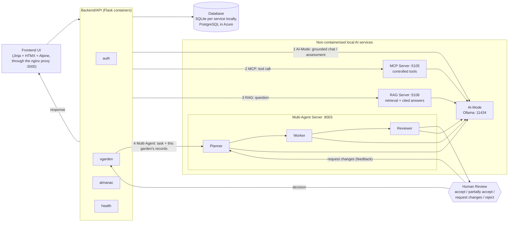
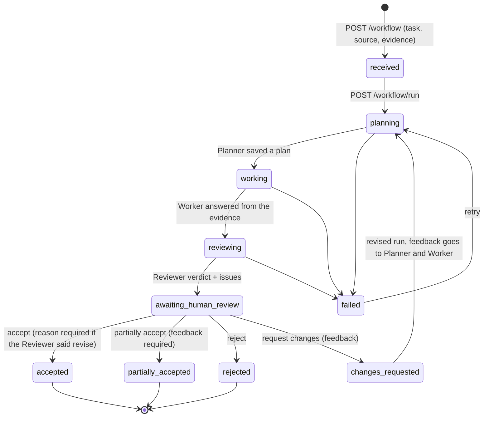
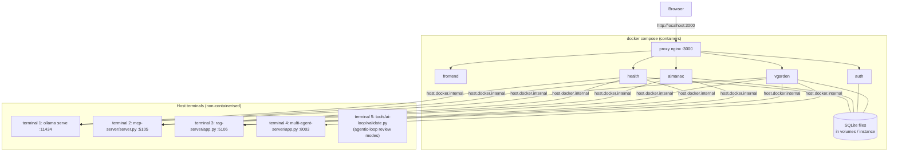
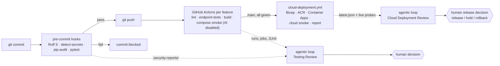

# Release 2 design flow

Diagrams for the technical report. They render on GitHub, or paste a block into
<https://mermaid.live> to export a PNG. The cloud deployment and CI/CD architecture
is in [`docs/deployment/azure.md`](../../deployment/azure.md) §1.

## 1. Application design flow

The required flow: Frontend UI → Backend/API → Database, the Release 1 AI-Mode,
MCP and RAG flows, and the Release 2 Multi-Agent flow.

| Flow | Path | Code |
|---|---|---|
| CRUD | UI → backend → database | each service's `routes.py`, Flask-Migrate |
| 1. AI-Mode | UI → backend → Ollama (Plan → Act → Observe → Adapt) → UI | `shared/ai_loop.py`, `*/ai.py` |
| 2. MCP | UI → backend → MCP Server → the owning service's API → UI | `ai-services/mcp-server/` |
| 3. RAG | UI → backend → RAG Server → retrieval + Ollama → cited answer → UI | `ai-services/rag-server/` |
| 4. Multi-Agent | UI → vgarden → Multi-Agent Server → Planner → Worker → Reviewer → Human Review on the garden page → response | `vgarden/garden_workflows.py`, `ai-services/multi-agent-server/` ([evidence](multi-agent-vgarden.md)) |

## 2. Multi-Agent workflow states

Every transition is an event in the server's SQLite store, exported by `audit.py` as
[`workflow_history.jsonl`](workflow_history.jsonl) and
[`coordination_audit.jsonl`](coordination_audit.jsonl).

## 3. Local deployment

Checked by [`scripts/test/local-deployment-check.sh`](../../../scripts/test/local-deployment-check.sh);
the saved run is [`local-deployment/`](local-deployment/).

## 4. Testing and release evidence pipeline

| Stage | Evidence |
|---|---|
| Pre-commit | [`pre-commit-yunus.md`](pre-commit-yunus.md) (`scripts/security/report.py`) |
| Post-commit CI | GitHub Actions runs and the `*-test-evidence-*` artifacts |
| Agentic-loop reviews | `review-*.json` here, logs in `tools/ai-loop/logs/reports/review-*/` |
| Cloud deployment | `cloud-deployment/latest.md` / `latest.json` (from `scripts/deploy/azure-report.sh`) |
