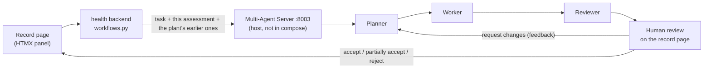

# Multi-Agent workflow evidence: Plant Health

Release 2 criteria 1–2 for the Plant Health feature: the shared, non-containerised
Multi-Agent Server runs Planner → Worker → Reviewer → Human Review on one plant
health assessment, through both the **frontend UI** (the record page's HTMX panel)
and the **terminal**, with workflow history and coordination/audit evidence.

Recorded 21 Oct 2026 on an 8 GB M1, with `qwen3:4b-instruct` for all three agent
roles. The two assessments are real `qwen2.5vl:3b` output, created through
`POST /plant-health-records/assessments`. Health ran directly (`flask run --port
5060`, MCP and RAG off). The Multi-Agent Server ran on `:8003`.

## Flow



| Step | Where |
| --- | --- |
| Panel on each record page; polls every 3 s while agents run | `health/templates/_workflows_panel.html`, `_workflow.html` |
| Routes: start, status, run again, review | `health/workflows.py` |
| HTTP client (`create` / `run` / `status` / `review`) | `health/integrations.py` → `MultiAgentClient` |
| Workflow ↔ assessment link, deleted with the assessment | `HealthWorkflow`, migration `0006_health_workflows` |
| `source="health"`, supplied evidence required; health prompts | `ai-services/multi-agent-server/app.py`, `planner.py`, `worker.py` |
| Off switch (CI, cloud baseline) | `MULTI_AGENT_ENABLED=false` (`docker-compose.yml`, `health.yml`, `infra/apps.bicep`) |

**Evidence sent:** passages `health-<id>-assessment` (status, score, confidence,
summary, description), `-issues`, `-recommendations` (plus missing information)
and `-history` (up to 5 earlier assessments of the **same plant**). Every field is
labelled and gaps are stated as "not recorded". The passage says the assessment is
an earlier AI opinion, not a diagnosis, and the Worker is told not to add causes or
treatments that aren't in it. Another plant's records are never sent.

## Terminal run

[`terminal-run.txt`](terminal-run.txt), from `bash scripts/test/multi-agent-health.sh`.
This goes through the health backend's JSON API, so the evidence is built by the
same code the UI uses.

`received → planning → working → reviewing → awaiting_human_review →
changes_requested → planning → working → reviewing → awaiting_human_review →
partially_accepted` (workflow `b3a742fd`, reviewer `yunus-terminal`). The
non-interactive run used the script's cautious default: the Reviewer still said
`revise`, so it **partially** accepted. Run it in a terminal to make the decision
yourself.

## UI run (real HTTP, the requests the record page sends)

[`ui-http-run.txt`](ui-http-run.txt): `GET` the record page (panel present) →
`POST …/workflows` (201, polling) → polled every 3 s for 41 s → Worker answer citing
the record's issue and its high-priority recommendation; Reviewer `revise` →
**Request changes** "Also say what information the record says is missing" →
revised run (24 s) adds the missing information and the earlier assessment →
**Partially accept** (the Reviewer still flagged claims). Workflow `6066982d`,
reviewer `health-user-web`.

## Audit and review

- [`workflow_history.jsonl`](workflow_history.jsonl) and
  [`coordination_audit.jsonl`](coordination_audit.jsonl): the server's `audit.py`
  records for the two health workflows (22 events each). `multi-agent-metrics.json`
  is `/workflow/metrics` for the whole server, which also includes vgarden.
- [`multi-agent-review-health.md`](multi-agent-review-health.md): the agentic
  loop's Multi-Agent review of these workflows (`validate.py --mode multi-agent
  --source health`), including grounding and the live integration checks.

## Tests

```sh
cd health && python -m pytest -q tests/test_workflows.py                       # 19 tests
cd ai-services/multi-agent-server && python -m pytest -q tests/test_sources.py  # incl. health source
```

The tests cover:
- only this assessment and the same plant's history are sent;
- gaps are stated;
- every human decision, with requested changes starting a revised run and no second decision;
- polling and retry;
- workflows scoped to their assessment (404 otherwise);
- task validation;
- a disabled (503) or unreachable (502) server creates nothing;
- the disabled panel;
- delete cascade;
- `/integrations`;
- the client's error mapping.

## Limitations

- The UI has no sign-in, so UI decisions are recorded as `health-user-web`. JSON
  callers such as the terminal script may label themselves (`reviewer_id`); it is a
  label, not an identity check.
- The vision model was run without its reviewer model (`OLLAMA_REVIEW_MODEL=`) to
  stay within 8 GB, so these two assessments are single-pass AI output.
