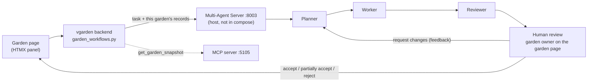

# Multi-Agent workflow evidence: Virtual Garden (Yunus Sayed)

Release 2 criterion 2: the shared, non-containerised Multi-Agent Server runs
Planner → Worker → Reviewer → Human Review for the Virtual Garden feature, through
both the **frontend UI** and the **terminal**, with workflow history and
coordination/audit evidence.

## Flow



| Step | Where |
| --- | --- |
| Panel on each garden page; polls every 3 s while agents run | `vgarden/templates/_workflows_panel.html`, `_workflow.html` |
| Owner-scoped routes: start, status, run again, review | `vgarden/garden_workflows.py` |
| HTTP client (`create` / `run` / `status` / `review`) | `vgarden/integrations.py` → `MultiAgentClient` |
| Workflow ↔ garden link (owner check stays in vgarden) | `GardenWorkflow` model, migration `0002_garden_workflows` |
| `source="vgarden"` + supplied evidence; garden prompts | `ai-services/multi-agent-server/app.py`, `planner.py`, `worker.py` |
| Off switch (CI, cloud baseline) | `MULTI_AGENT_ENABLED=false` (`docker-compose.yml`, `vgarden.yml`) |

### Keeping private garden data private

- Every route requires login and garden ownership. A stranger gets a 404, the same as
  the rest of Virtual Garden.
- The browser only names a local `GardenWorkflow` row under a garden it owns. The
  server's workflow ID is looked up from that row and is never taken from the browser.
- The Multi-Agent Server **never reads garden data**. Virtual Garden sends the one
  garden's records as `evidence`, read through MCP `get_garden_snapshot` when MCP is
  on (otherwise from its own snapshot). The server rejects a `vgarden` task without
  evidence.
- The Worker answers only from those records and cites passage IDs
  (`garden-<id>-summary|areas|containers|plantings`). The Reviewer checks the answer
  against the same records.

## Running it (multiple terminals)

```sh
# terminal 1: Ollama (host)
ollama serve
# terminal 2: shared MCP server (optional, used to read the garden snapshot)
python ai-services/mcp-server/server.py
# terminal 3: Multi-Agent Server
cd ai-services/multi-agent-server && python app.py
# terminal 4: the containerised app
docker compose up -d
# then: http://localhost:3000 → a garden → "Agent workflow" panel
# terminal 5: the same workflow from the terminal (asks for your decision)
bash scripts/test/multi-agent-vgarden.sh
```

The server's read-only dashboard is at http://127.0.0.1:8003/dashboard, with links to
download the audit files.

## Terminal run

Full transcript: [`multi-agent-terminal-run.txt`](multi-agent-terminal-run.txt)
(workflow `ea2f3224`, 21 Oct 2026, `qwen3:4b-instruct` for all three roles).

| Stage | Result |
| --- | --- |
| Task | "Which plantings in the North bed are flowering, and when were they planted?" |
| Run 1: Worker | "Tomato - flowering; planted 2026-09-01. Basil is not flowering. …" |
| Run 1: Reviewer | `revise`: basil's growth stage is not recorded, so "Basil is not flowering" is unsupported |
| Human | `request_changes`: "Also say how many tomato plants there are." |
| Run 2: Worker | "… tomato plants are flowering. They were planted on 2026-09-01. There are 3 tomato plantings …" |
| Run 2: Reviewer | `revise`: still flags the basil claim, and calls "plantings" (vs. plants) unsupported |
| Human | `partially_accept`: approves only the claims the Reviewer did not flag |

History: `received → planning → working → reviewing → awaiting_human_review →
changes_requested → planning → working → reviewing → awaiting_human_review →
partially_accepted`. Each agent run took 33–39 s on an 8 GB M1.

## All recorded workflows

Audit exports: [`workflow_history.jsonl`](workflow_history.jsonl) (every event, with
plan, evidence, answer, review and decision) and
[`coordination_audit.jsonl`](coordination_audit.jsonl) (handoffs, model per role,
decisions). Both were produced by `python audit.py`. Metrics:
[`multi-agent-metrics.json`](multi-agent-metrics.json).

| Workflow | Path | Outcome | What it showed |
| --- | --- | --- | --- |
| `ba579e19` | vgarden backend routes (UI path) | accepted with a reason | Full flow in 30 s. The Reviewer said `revise`, so accepting required a written reason (the override rule). |
| `f7633348` | terminal | accepted | **Bug found:** requested changes reached the Planner but not the Worker, so the revised answer dropped the requested tomato count. |
| `a7567b60` | terminal, after the fix | accepted (scripted) | The fix worked: the revised answer gave "3 tomato plants". The script then accepted despite `revise`, so it was changed to ask a human instead. |
| `8dfb6fda` | terminal | partially accepted | Cautious default. The Worker still mixed up basil and tomato, so the evidence format was changed to label every field. |
| `ea2f3224` | terminal | partially accepted | Labelled fields: answers are factually correct; the Reviewer is strict rather than wrong (above). |
| `7c228ba1` | **UI over real HTTP**: SSO login, CSRF, background run, 3 s polling | accepted | Start (201) → polled to review → Request changes ("how many tomato plants") → the panel kept polling through the revised run → "There are 3 tomato plants…", Reviewer `accept` → Accept. A POST without a CSRF token was refused (400). |

Fixes made because of these runs:
- The Worker now receives the human's `requested_changes` on a revised run.
  First-run prompts are unchanged (`worker.py` `REVISION`, tested in
  `test_workflow.py` and `test_sources.py`).
- Garden plantings are sent as labelled fields with gaps stated, e.g.
  `Basil - quantity 6; status sown; growth stage not recorded; …`
  (`garden_workflows.py::garden_evidence`).

Metrics after these runs: 6 tracked workflows, 11 agent runs, handoff, plan-generation
and worker-completion rates all 1.0 (33/33 stages), and every workflow closed by a
human decision (4 accepted, 2 partially accepted).

## Tests

```sh
cd vgarden && python -m pytest -q tests/test_workflows.py                   # 15 tests
cd ai-services/multi-agent-server && python -m unittest discover -s tests   # 25 tests
```

The Virtual Garden tests use a fake that follows the server's state machine. They
cover: only this garden's records are sent; evidence comes through MCP when it's on;
every human decision (feedback rules, requested changes start a revised run, no second
decision); polling while running; retry after a failure; owner scoping (start, view,
run and review all 404 for another owner's garden or workflow); login; task
validation; disabled (503) and unreachable (502) servers create nothing; the
disabled panel; cascade on garden delete; and the HTTP client's error mapping. The
server tests cover the evidence rules, that a `vgarden` workflow never triggers MCP
retrieval, the per-source prompts, and that feedback reaches the Worker.

## Screenshots to take for the report and video

1. A garden page with the Agent workflow panel and a task typed in.
2. The panel while running (stage badges plus "Running locally…").
3. The finished panel: plan, Worker answer with citation, Reviewer issues, review form.
4. After **Request changes**: the revised run, then the final decision and history.
5. `http://127.0.0.1:8003/dashboard` showing the workflows and audit download links.
6. The terminal: `bash scripts/test/multi-agent-vgarden.sh`, making the decision.
7. The terminals side by side (Ollama, MCP, Multi-Agent Server, compose).

## Known limitations

- The server's `/dashboard` and audit files list every workflow's task text,
  including garden tasks. That's acceptable while the server is local only; it would
  need access control before enabling it in the cloud (bonus B4).
- Runs are tracked in memory by the Virtual Garden process. If Virtual Garden
  restarts mid-run, the page offers **Run workflow** instead of polling.
- With a 4B model, the Reviewer sometimes flags correct statements (for example,
  `ba579e19`), which is why the human decision is required.
