# Plant Management System — Release 2 Technical Report (group draft)

> **Status: final draft for the group.** Export to `group-<number>.pdf` (max 3000 words).
> Only the items marked **[group]** remain (the video URL and the recorded human
> decisions); everything else is drawn from the repository as of 22 October 2026.
> Diagrams: `docs/architecture/*.svg`. Evidence: `docs/evidence/release2/`.

| | |
| --- | --- |
| Repository | <https://github.com/Bageutter/Plant-Management-System> |
| Team | Amy Zhou (Plant Almanac), Yunus Sayed (Virtual Garden), Guhan Sundar (Plant Health) |
| Cloud platform | Microsoft Azure (Container Apps, australiaeast) |
| Showcase video | **[group] URL here** (max 10 min) |

## 1. Project overview

The Plant Management System is a microservice web application for small home gardens:
a **Virtual Garden** that is the source of truth for what is planted where, a **Plant
Almanac** of reference knowledge, and **Plant Health** assessments from photos and
descriptions, with shared **auth** and a shared **frontend/proxy**. Every service is
Flask + HTMX + Alpine.js + Jinja (Franken UI) on SQLite in development and PostgreSQL in
the cloud, behind one nginx proxy on `:3000`.

Release 1 added three shared, non-containerised local AI services reached only through
each feature's backend: **AI-Mode** (locally hosted Ollama), the **MCP server** (tools
over each feature's public API) and the **RAG server** (grounded answers with citations
and a confidence category), plus a shared agentic loop with MCP and RAG validation modes.

Release 2 extends that completed application with:

- one shared **Multi-Agent Server** (Planner → Worker → Reviewer → Human Review) that
  all three features call from their frontend UI through their own backend and that is
  also callable from the terminal;
- **local pre-commit security scans** (Ruff security rules, detect-secrets, pip-audit,
  plus the committer's feature tests) that run on every `git commit`;
- **post-commit CI/CD endpoint tests**: each student's workflow tests two endpoint
  functions of their backend after a push and keeps the evidence;
- **cloud deployment** of the integrated application to Azure through
  `cloud-deployment.yml`, Bicep and reusable scripts, with AI-Mode, MCP, RAG and the
  Multi-Agent Server disabled by default;
- the three Release 2 **agentic-loop review modes** (`tools/ai-loop/validate.py --mode
  multi-agent | testing | cloud-deployment`) that review the saved evidence and write a
  review/validation log, alongside the Release 1 `mcp` and `rag` modes.

| Student | Feature microservices | Release 2 responsibilities |
| --- | --- | --- |
| Amy Zhou | Plant Almanac (UI, API, DB) | Multi-Agent Server (Planner/Worker/Reviewer, human review, audit, dashboard); shared pre-commit security tooling; `plant_almanac.yml` endpoint tests |
| Yunus Sayed | Virtual Garden (UI, API, DB); auth, proxy, compose, shared agentic loop | Virtual Garden ↔ Multi-Agent integration with owner-scoped human review; `vgarden.yml` endpoint tests; the Release 2 agentic-loop review modes (`tools/ai-loop/review.py`); Ollama moved out of compose; local-deployment check script |
| Guhan Sundar | Plant Health (UI, API, DB); MCP/RAG server skeletons | Plant Health ↔ Multi-Agent integration; `application_integration` helper; `health.yml` endpoint tests; Azure deployment pipeline; report evidence |

## 2. Final repository structure

```text
.github/workflows/      ruff.yml, integration-ci.yml, plant_almanac.yml (Amy), vgarden.yml (Yunus),
                        health.yml (Guhan), auth.yml, ai-services.yml, cloud-deployment.yml (Azure)
.pre-commit-config.yaml, .secrets.baseline, scripts/security/{install,run_checks,report}.py
auth/ vgarden/ almanac/ health/     feature microservices: app.py, routes, models, migrations/, templates/, tests/
shared/                 templates (nav), frontend, ai_loop.py (shared agentic loop runtime), proxy/
ai-services/mcp-server/           Release 1 shared MCP server (health, almanac, vgarden tools)
ai-services/rag-server/           Release 1 shared RAG server (health, almanac, vgarden sources)
ai-services/multi-agent-server/   Release 2: app.py, planner.py, worker.py, reviewer.py, human_review.py,
                                  application_integration.py, audit.py, store.py, templates/dashboard.html, tests/
tools/ai-loop/          validate.py (mcp, rag + multi-agent, testing, cloud-deployment modes), review.py, logs/ (JSONL + Markdown); tools/ai-dev/
infra/                  main.bicep, apps.bicep, modules/   scripts/deploy/   azure-*.sh (bootstrap → platform → build-push → apps → smoke → report)
scripts/deploy/azure-e2e.py       live end-to-end CRUD check
scripts/test/           smoke-*.sh, multi-agent-{vgarden,health,almanac}.sh (terminal runs)
docs/ai/                AI design (architecture, context, prompts, agentic loop, MCP/RAG design)
docs/architecture/      Release 2 design flow, Plant Health flow, cloud architecture, CI/CD pipeline (.mmd/.svg/.png)
docs/deployment/azure.md          cloud walkthrough
docs/evidence/release2/           design-flow.md, multi-agent evidence (vgarden + health), pre-commit-*.md, post-commit/,
                                  testing/, testing-review.md, multi-agent-review.md, local-deployment/ (+ health-guhan/),
                                  cloud-deployment/, contribution-*.md, github-commit-log.md
docs/report/            this report, showcase plan
docker-compose.yml      proxy, frontend, auth, vgarden, almanac, health (Ollama, MCP, RAG, Multi-Agent run on the host)
```

## 3. Release 2 design flow



(Mermaid sources: `docs/architecture/release2-design-flow.mmd`; Yunus's per-flow
diagrams: `docs/evidence/release2/design-flow.md`.)

**Frontend UI → Backend/API → Database.** Each page talks only to its own Flask backend
(HTMX fragments or JSON); each backend owns its database and schema migrations
(Flask-Migrate/Alembic, applied at start-up).

**Release 1 flows (retained).** *AI-Mode* runs inside agentic loops (Plant Health's
vision assessment with an independent reviewer model; the chats' Plan → Act → Observe →
Adapt). *MCP* and *RAG* are reached through each backend and read only the features'
public APIs; RAG answers with citations and a confidence category.

**Release 2 flow.** Frontend UI → Backend/API → `POST /workflow` on the Multi-Agent
Server → **Planner** (plans information-processing steps) → **Worker** (answers only
from the supplied evidence, citing passage ids) → **Reviewer** (checks the answer against
the same evidence, recommends accept/revise) → **Human Review** on the feature's own page
(accept, partially accept, request changes, reject; requested changes trigger a revised
run with the feedback) → response shown in the frontend UI. Evidence boundaries differ by
feature: the Almanac Worker retrieves public references through MCP; Virtual Garden sends
one garden's snapshot and Plant Health sends one plant's stored assessments, so the server
never reads private or feature-owned data itself.

### Plant Health design flow (Guhan)



The records page has four entry points, all routed through `health/routes.py` and
`health/workflows.py`: the assessment form (AI-Mode + agentic loop), the MCP tools
panel, the RAG panel, and the new *Agent workflow* panel. The workflow panel sends the
task plus a history-summary passage and up to eight of the plant's assessments (read
through the MCP server's `list_health_assessments`/`get_health_assessment` tools when MCP
is on, otherwise from the database), polls the backend every 3 s while the three agents
run, and records the gardener's decision.

### Plant Almanac design flow (Amy)

The Almanac chat gains a *Multi-Agent* mode beside Planning, RAG and MCP. `POST /ai/ask
mode=multi_agent` saves the question, sends only the task (Almanac data is public) and
runs the agents; the Worker retrieves Almanac passages itself through the MCP server's
`retrieve_context` tool (backed by RAG over the public catalogue API) and cites them.
The answer appears in the chat with a readable review: the Reviewer's concerns, the exact
saved source facts and what is not recorded, and the four decision controls
(`/ai/multi-agent/<message_id>`, owner only).

### Virtual Garden design flow (Yunus)

Each garden page has an *Agent workflow* panel (`vgarden/garden_workflows.py`). The
backend checks the signed-in user owns the garden, builds labelled evidence passages from
that garden's snapshot only (areas, containers, plantings, gaps stated) and sends them
with the task; the Multi-Agent Server never reads garden data itself. The panel polls
while the agents run, shows the cited passages and the Reviewer's verdict, and records
the owner's decision; requested changes start a revised run. Workflows are stored per
garden (`GardenWorkflow`) and deleted with it.

## 4. Cloud deployment and CI/CD architecture



The cloud layout mirrors `docker-compose.yml`: the same six images in one **Azure
Container Apps** environment inside a VNet, the nginx **proxy** as the only public HTTPS
ingress, the five services on internal ingress, one **PostgreSQL Flexible Server**
(private subnet, one database per service), **Key Vault** for secrets read through a
managed identity, **Container Registry** (images tagged with the commit SHA), **Azure
Files** for Almanac images and **Log Analytics**. GitHub Actions signs in with OIDC, so
no cloud credential is stored in GitHub. The cloud baseline keeps AI-Mode, MCP, RAG and
the Multi-Agent Server **disabled** (`MCP_ENABLED=false`, `RAG_ENABLED=false`,
`MULTI_AGENT_ENABLED=false`, unreachable `OLLAMA_URL`); the smoke step asserts the
`/integrations` endpoints report exactly that.



**DevOps flow.** Source control (feature branch) → local pre-commit scans on `git commit`
→ push / pull request → GitHub Actions: `ruff.yml`, `integration-ci.yml` and the three
student workflows run the two assigned endpoint functions per student (JUnit + logs kept
as artifacts) → Docker build and compose smoke validation → merge to `main` →
`cloud-deployment.yml` re-runs the gates (lint, endpoint tests ×4 services, build +
smoke) → the `azure-production` environment's required reviewers give the human release
decision → `azure-platform.sh` (Bicep) → `azure-build-push.sh` → `azure-apps.sh` →
`azure-smoke.sh` → `azure-report.sh` writes the deployment report into
`docs/evidence/release2/cloud-deployment/`.

## 5. Pre-commit security testing

`.pre-commit-config.yaml` installs four local hooks (`scripts/security/install.py
<service>`), each a stdlib launcher that runs the tool from an isolated virtual
environment and stores JSON evidence under `.security-reports/`:

| Hook | Tool | Scope |
| --- | --- | --- |
| `ruff-security` | Ruff `--select S` (Bandit-derived rules) | staged Python files |
| `detect-secrets` | `detect-secrets-hook --baseline .secrets.baseline` | staged files |
| `pip-audit` | `pip-audit -r <service>/requirements-dev.txt` | services with staged changes |
| `pytest` | the committer's feature tests with AI services disabled | `<service>/tests` |

A failing hook blocks the commit; findings are fixed or carry a reviewed `# noqa` with a
reason. During Release 2 the hooks were made cross-platform (`language: python`) after
the `python3` launcher failed on Windows. Per-student reports (generated by
`scripts/security/report.py`, raw output never shared):

| Student | Latest result | Report |
| --- | --- | --- |
| Guhan Sundar (health) | full scan of the health service + the hook runs on this release's commits — see the page for counts | `docs/evidence/release2/pre-commit-guhan.md` |
| Yunus Sayed (vgarden, auth) | all four checks PASS for both services (10 Ruff security findings fixed first); 137 + 10 tests | `docs/evidence/release2/pre-commit-yunus.md` |
| Amy Zhou (almanac) | all four checks PASS: Ruff 0 findings, no new secrets, 49 packages with 0 known vulnerabilities, 104 tests | `docs/evidence/release2/pre-commit-amy.md` |
| All services | one page scanning every service, for the Testing review | `docs/evidence/release2/pre-commit-all-services.md` |

## 6. Post-commit CI/CD endpoint testing

Each student's workflow runs the two assigned backend functions by name after every
push, then the rest of the suite as regressions, and uploads `endpoints.xml`,
`endpoints.log`, `regressions.xml`, `regressions.log` and `run.json` (source SHA, run
URL, function names) as a 30-day artifact — including when a test fails. Docker builds
depend on lint and tests passing. Tests use temporary SQLite and fakes for the model and
shared servers, so no AI service runs in CI.

| Student · workflow | Backend function | Route | Test |
| --- | --- | --- | --- |
| Amy · `plant_almanac.yml` | `catalogue_api.search` | `GET /api/catalogue` | `test_public_catalogue_search_pages_and_literal_search` |
| | `catalogue_api.plant` | `GET /api/catalogue/plant/<slug>` | `test_public_details_preserve_evidence_and_make_no_writes` |
| Yunus · `vgarden.yml` | `routes.create_garden` | `POST /gardens` | `test_create_garden_validates_input_and_persists` |
| | `routes.garden_snapshot` | `GET /gardens/<id>/snapshot` | `test_garden_snapshot_returns_scoped_evidence_and_makes_no_writes` |
| Guhan · `health.yml` | `routes.create_assessment` | `POST /plant-health-records/assessments` | `test_create_assessment_validates_input_and_persists` |
| | `routes.list_assessments` | `GET /plant-health-records/assessments` | `test_list_assessments_filters_pages_and_makes_no_writes` |

### 6.3 Plant Health (Guhan)

`test_create_assessment_validates_input_and_persists` covers every validation path
(empty body, over-long fields, wrong types, bad or unsupported images) and the 503 when
the local model is down — all writing nothing — then the 201 response, persistence of
the record, its agentic-loop run and the plant title, history passed on a repeat
assessment, a photo stored and served back, and the HTMX fragment.
`test_list_assessments_filters_pages_and_makes_no_writes` covers the empty list,
newest-first order, the `plant_ref`/`status`/`since` filters and their 400s,
`limit`/`offset` clamping, that image bytes never travel in the listing, and that
repeated reads change nothing.

| Evidence | Value |
| --- | --- |
| Commit | `c11bc73e82` (PR #77) |
| Successful push run | <https://github.com/Bageutter/Plant-Management-System/actions/runs/39560544593> (all jobs green) |
| Result | endpoints: 2 passed · regressions: 60 passed |
| Artifact | `health-test-evidence-39560544593-1`, in `post-commit/health-guhan/` |

### 6.1 Plant Almanac (Amy) · 6.2 Virtual Garden (Yunus)

Successful **push** runs on `main`; each artifact is downloaded unchanged into
`docs/evidence/release2/post-commit/<feature>-<student>/` with a README.

| Workflow | Commit | Push run | Result |
| --- | --- | --- | --- |
| `plant_almanac.yml` (Amy) | `02b2deabd0` | <https://github.com/Bageutter/Plant-Management-System/actions/runs/39624128438> | endpoints 2 passed · regressions 105 passed (`almanac-amy/`) |
| `vgarden.yml` (Yunus) | `1e1a85fbb3` | <https://github.com/Bageutter/Plant-Management-System/actions/runs/39624166823> | endpoints 4 passed (the two assigned + two coverage tests) · regressions 135 passed (`vgarden-yunus/`) |

**Almanac.** `catalogue_api.search`: `limit`/`offset` paging without overlap,
case-insensitive literal matches on common and scientific names, `kind` filters, empty
results, `400` with a reason for bad parameters, and the `/almanac` prefix behind the
proxy. `catalogue_api.plant`: details include pests, diseases and the evidence note, unknown
records are `404`, non-GET methods are refused, and reads change no row.

**Virtual Garden.** `create_garden` (called by auth): no service token is refused;
invalid bodies are `400` and write nothing; a valid request is `201` and stores exactly
one garden that reads back identically. `garden_snapshot`: needs the token, `404` for a
missing garden, returns only that garden's areas, containers and plantings, and repeated
reads change no row.

The brief's `student-x.yml` maps to `plant_almanac.yml` (Amy), `vgarden.yml` (Yunus) and
`health.yml` (Guhan).

## 7. Testing review (agentic loop)

`tools/ai-loop/validate.py --mode testing` reviews the pre-commit pages (§5) and every
service's test run with endpoint coverage (`docs/evidence/release2/testing/`) through the
Plan → Act → Observe → Adapt loop with a reviewer model, and writes
`docs/evidence/release2/testing-review.md` + `review-testing.json` plus the validation
log `tools/ai-loop/logs/review-testing.jsonl`. An early run returned **not_ready** before
every service's evidence was merged; the final run
`review-testing-20261021-134337-18a37a` returned **ready_with_fixes**: 50 checks pass and
4 warn (endpoints without a test, kept as follow-ups); every pre-commit check passed with
no vulnerabilities or secrets. Human decision: **accept** by Amy — "The required tests
pass; keep the six coverage gaps as follow-up improvements."

## 8. Local deployment evidence

Two independent local runs, both in `docs/evidence/release2/local-deployment/`:
Yunus's on macOS (`check.txt`: 31 of 31 checks — containers up, no AI service in
compose, each host service healthy, every backend reachable through the proxy and
reaching the host services from inside its container) and Guhan's on Windows/WSL
(`health-guhan/`, one log per terminal: compose, MCP, RAG, Multi-Agent, a Plant Health
walkthrough and `multi-agent-health.sh`). In both, the containers ran under Docker
Compose and the AI services as separate host processes; the `/integrations` endpoints
reported MCP, RAG and Multi-Agent enabled and reachable; AI-Mode assessments ran through
the vision model and reviewer loop (23–126 s each), the MCP tool answered in 127 ms and
RAG in 28 s with two citations; and workflows completed Planner → Worker → Reviewer →
human review from both the terminal and the records page.

## 9. Cloud deployment report and review

**Deployment report** (`docs/evidence/release2/cloud-deployment/latest.md`, written by
`azure-report.sh`): Azure for Students, `rg-plantms-prod` (australiaeast), commit
`0f88ba4`, workflow run
<https://github.com/Bageutter/Plant-Management-System/actions/runs/39680594970>. All six
gates passed (Ruff, endpoint tests for auth/vgarden/almanac/health, Docker build + compose
smoke), then the `azure-production` environment's required reviewer (yunz-dev)
**approved** the release and the deploy job succeeded with the smoke test **PASS**. Six
container apps run (only the proxy public), PostgreSQL 16 has no public access, and
AI-Mode, MCP, RAG and Multi-Agent are disabled.

Live URL: <https://plantms-prod-proxy.thankfulsky-694df0b7.australiaeast.azurecontainerapps.io>.

**Integrated CRUD in the cloud.** `scripts/deploy/azure-e2e.py` signs up through the
public URL and exercises every feature (`cloud-deployment/e2e-crud.txt`): **16/16
passed** — garden create/rename/delete (auth → vgarden), area and planting create, edit
and delete, Almanac plant create/update/read/delete with the auth session, Plant Health
titles and records created ("not assessed", since AI-Mode is off), read, updated and
deleted, and the disabled-AI baseline. Services scale to zero to save credit, so the
first request after idle takes about 30 s (`docs/deployment/azure.md` has the warm-up).

**Cloud Deployment Report Review** (`validate.py --mode cloud-deployment`):
`docs/evidence/release2/cloud-deployment-review.md` + `review-cloud-deployment.json`, log
`tools/ai-loop/logs/review-cloud-deployment.jsonl`. Run
`review-cloud-deployment-20261022-034848-6848f2`: verdict **ready**, 13/13 checks (report,
baseline, smoke, ingress, private database, CI before deploy, five live paths, latest
deploy run). An earlier run failed CD-8–CD-W because the reviewer's own network dropped;
it is kept in the log. Final human release decision: **[group]** record with `--decision
release|hold|rollback`.

## 10. Multi-Agent workflow evidence

Server-side evidence for every workflow: `GET /workflow/status` (plan, evidence, answer,
review, human decision, full history) and the audit exports
`workflow_history.jsonl` (every event) and `coordination_audit.jsonl` (hand-offs, model
per role, decisions), also downloadable from `/dashboard`.

| Feature | Evidence | What it shows |
| --- | --- | --- |
| Virtual Garden (Yunus) | `docs/evidence/release2/multi-agent-vgarden.md`, `multi-agent-terminal-run.txt`, `workflow_history.jsonl`, `coordination_audit.jsonl`, `multi-agent-metrics.json` | Six workflows through the UI and the terminal; a Worker bug found and fixed from the audit; human decisions including request-changes and partial acceptance |
| Plant Health (Guhan) | `docs/evidence/release2/local-deployment/health-guhan/` (terminal 6 transcript, UI run write-up, `workflow_history.jsonl`, `coordination_audit.jsonl`, `multi-agent-metrics.json`, `health-workflows.json`) | Terminal: workflow `a7f23d6d` through the health backend with evidence read via MCP — two agent runs, a human request for changes that reached both the Planner and the Worker, a Reviewer `revise` on each run, partial acceptance. UI: workflow `ae71c81a` started and accepted (with the required reason) from the records page. The first attempt exposed and fixed a Reviewer failure mode (mangled quote → failed stage) |
| Plant Health (terminal + UI, shared server) | `docs/evidence/release2/health-multi-agent/` | Terminal workflow `b3a742fd` and UI workflow `6066982d`, each with request changes → revised run → partial acceptance |
| Plant Almanac (Amy) | `docs/evidence/release2/almanac-multi-agent/` (two terminal runs, UI run, audit, metrics), `almanac-review/` (readable review UI, screenshots) | Terminal: `f0a706d0` — no companion data, so the Worker refused rather than guessed, accepted; `8a8bae49` — correct planting months, partially accepted after a Reviewer `revise`. UI: `120184b5` from the chat, request changes → revised run → partial acceptance by the signed-in user |
| Agentic-loop *Multi-Agent review* | `multi-agent-review.md` (vgarden), `health-multi-agent/multi-agent-review-health.md`, `almanac-multi-agent/multi-agent-review-almanac.md`, log `tools/ai-loop/logs/review-multi-agent.jsonl` | All three verdict **ready**, 13/13 checks: runs in order, every workflow closed by a human, every change request re-run, handoffs name their model, UI and terminal reviewers, citations grounded, live server reachable. Human decisions **[group]** to record |

## 11. GitHub commit logs

<https://github.com/Bageutter/Plant-Management-System/commits/main> — each student's
Release 2 commits and pull requests are listed in
`docs/evidence/release2/github-commit-log.md` (per-author filters:
`?author=0melette`, `?author=yunz-dev`, `?author=Bageutter`).

## 12. Contribution logs

| Student | Log |
| --- | --- |
| Guhan Sundar | `docs/evidence/release2/contribution-guhan.md` |
| Yunus Sayed | `docs/evidence/release2/contribution-yunus.md` |
| Amy Zhou | `docs/evidence/release2/contribution-amy.md` (Amy to confirm) |

## 13. Bonus evidence

No bonus marks are claimed.

## 14. Showcase video URL

**[group]** Published URL (max 10 minutes, all students). Script:
`docs/evidence/release2/video-script.md` (earlier shot list: `docs/report/showcase-video-plan.md`).
